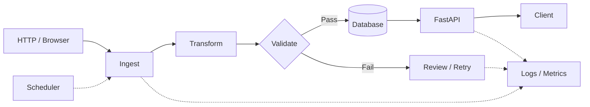

<div align="center">


<br />

<a href="https://datapark.space"></a>
<a href="https://github.com/datapark1018?tab=repositories"></a>


</div>

<br />

## `> whoami`

**Engineer-minded. Systems-first.**

I like building the parts that make software useful in the real world: **APIs, data pipelines, automation, observability, and local AI**. Less magic, more reproducible behavior.

```text
INPUT  →  PROCESS  →  VALIDATE  →  STORE  →  SERVE  →  OBSERVE
```

## `> tech --stack`

<div align="center">


</div>

<details open>
<summary><b>Backend / APIs</b></summary>
<br />


</details>

<details open>
<summary><b>Data / Pipelines</b></summary>
<br />


</details>

<details open>
<summary><b>Web Automation / Collection</b></summary>
<br />


</details>

<details open>
<summary><b>AI / Inference</b></summary>
<br />


</details>

<details open>
<summary><b>Runtime / Operations</b></summary>
<br />


</details>

<br />

## `> ls ./engineering`

<table>
<tr>
<td width="50%" valign="top">

### `01 / Backend Systems`

**FastAPI · REST · Streaming · Auth**

Designing predictable endpoints, validating inputs, keeping state isolated, and making errors observable.

</td>
<td width="50%" valign="top">

### `02 / Data Engineering`

**SQL · ETL · Scheduling · Quality**

Idempotent jobs, clean schemas, traceable transformations, and data checks before downstream use.

</td>
</tr>
<tr>
<td width="50%" valign="top">

### `03 / Browser Automation`

**Playwright · HTTP Clients · Async I/O**

Understanding browser behavior, managing concurrency, and handling flaky networks without hiding failures.

</td>
<td width="50%" valign="top">

### `04 / Local AI`

**Ollama · Transformers · PyTorch**

Inference latency, streaming tokens, model quantization, output validation, and speech interfaces.

</td>
</tr>
</table>

## `> cat system-design.md`

A typical data-to-service flow I like to reason about:



> **Principles:** make failures visible · prefer simple interfaces · measure before optimizing · automate the repeatable parts.
